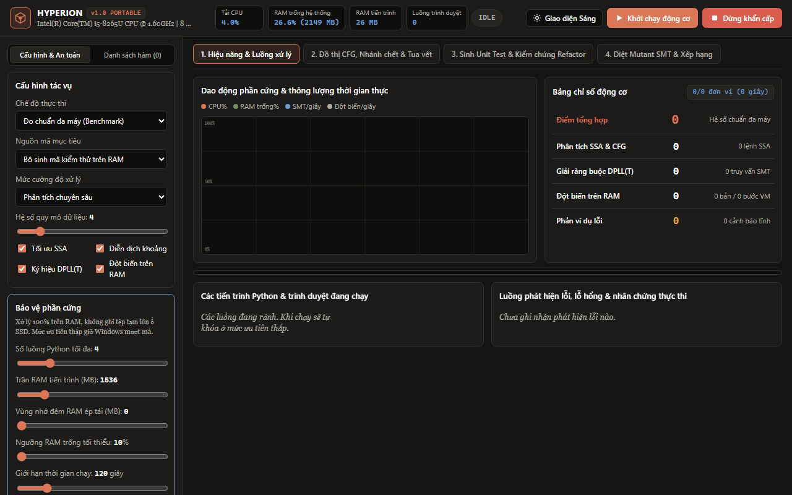

# HYPERION — Nền tảng Phân tích Tĩnh, Thực thi Ký hiệu DPLL(T), Sinh Unit Test & Kiểm thử Đột biến

**HYPERION** là nền tảng phân tích mã nguồn đa ngôn ngữ (Python & TypeScript/DSL) và kiểm chứng phần mềm **100% Portable**, vận hành hoàn toàn bằng thư viện chuẩn Python 3.10+ và mô-đun trình duyệt thuần (không phụ thuộc CDN ngoài, không cần `node_modules`). Hệ thống có thể chạy trực tiếp từ ổ cứng rời `Win10_SSD` trên bất kỳ máy Windows nào mà không cần cài đặt gói vào ổ hệ thống.



## Overview (English Summary)

**HYPERION Verifier** is a self-contained static analysis, symbolic execution, and mutation-testing workbench built solely on the Python 3.10+ standard library and zero-bundler TypeScript/JavaScript frontend assets.

- **Polyglot SSA IR & `DPLL(T)` SMT Core**: Lifts Python and TypeScript/DSL code into a Unified SSA IR with CFG/dominator/DFG analysis, interval + taint abstract interpretation, and an in-house `DPLL(T)` solver.
- **Automated Test Synthesis & Refactor Equivalence**: Generates `pytest`, `vitest`, and `jest` suites backed by the `IRInterpreter` VM, and formally proves behavioral equivalence (or emits exact counterexamples) between original and refactored functions.
- **In-Memory Mutation Killing & `UNSAT` Dead-Branch Replay**: Evaluates `AOR`/`ROR`/`LCR`/`CR`/`BSR` mutants in RAM, synthesizes differential inputs to kill `SURVIVED` mutants, detects `UNSAT` unreachable branches, and supports step-by-step execution trace replay.
- **Memory & Disk Protection**: Runs 100% in RAM with SQLite `PRAGMA journal_mode=MEMORY;`, `BELOW_NORMAL_PRIORITY_CLASS` worker throttling, live RAM floor/ceiling fuses, and an emergency stop under `50ms`.
- **Web Studio**: Interactive Vietnamese-first UI featuring Warm-Dark (`#141413`) and Warm-Light (`#faf9f5`) themes, real-time telemetry oscilloscope, interactive CFG canvas, and multi-panel verification workspace (`http://127.0.0.1:8765/`).

---

## Giao diện Web Studio (Warm-Dark & Warm-Light)

Giao diện `Web Studio` được thiết kế tối giản theo bảng màu tương phản dịu mắt (hỗ trợ chuyển đổi trực tiếp giữa **Giao diện Tối `#141413`** và **Giao diện Sáng `#faf9f5`**), tối ưu không gian hiển thị ở độ phân giải chuẩn `1280x800`:

- **Thanh bên chuyển nhanh 2 ngăn**: Chuyển đổi tức thì giữa **Cấu hình & An toàn** (chế độ chạy, nguồn mã, vùng nhớ đệm RAM ép tải, ngưỡng RAM trống) và **Danh sách hàm** đã phân tích.
- **Tab 1 — Hiệu năng & Luồng xử lý**: Biểu đồ dao động phần cứng thời gian thực (CPU%, RAM trống%, SMT/giây, Đột biến/giây) đặt cạnh bảng chỉ số động cơ và luồng theo dõi tiến trình / nhân chứng lỗi.
- **Tab 2 — Đồ thị CFG, Nhánh chết & Tua vết**: Vẽ đồ thị luồng điều khiển (`CFG`), cây chế ngự, luồng dữ liệu `DFG`, tô nổi các nhánh chết `UNSAT` và điều khiển tua từng bước (`Bước trước` / `Bước tiếp`) trạng thái biến thực tế.
- **Tab 3 — Sinh Unit Test & Kiểm chứng Refactor**: Phân tách 3 ngăn con gọn gàng (**Phân tích nhanh**, **Sinh Unit Test**, **Kiểm chứng Refactor**) giúp thao tác trực tiếp mà không phải cuộn trang dài.
- **Tab 4 — Diệt Mutant SMT & Xếp hạng**: Bảng ma trận đột biến trên RAM, nút tiêu diệt mutant sống sót bằng SMT và bảng xếp hạng benchmark đa máy trên SQLite.

## Kiến trúc & Bộ 3 Vũ khí Thực chiến

1. **Tự động sinh Unit Test (`pytest` / `vitest` / `jest`) & Kiểm chứng Tương đương khi Refactor** (`hyperion/testgen/generator.py`, `hyperion/equivalence/prover.py`):
   - Tự động tổng hợp bộ kiểm thử `pytest` (Python) và `vitest` / `jest` (TypeScript/JavaScript) phủ kín các nhánh rẽ, giá trị biên và phản ví dụ lỗi, được xác nhận giá trị kỳ vọng trực tiếp bằng máy ảo `IRInterpreter`.
   - **Kiểm chứng Tương đương (`Equivalence Prover`)**: Nâng đồng thời `Hàm Cũ` và `Hàm Mới` về chung dạng `Unified SSA IR`, sau đó dùng bộ giải `DPLL(T)` đối chiếu toàn bộ cặp đường chạy khả thi để chứng minh hai hàm tương đương toán học (`EQUIVALENT`) hoặc chỉ ra chính xác vector đầu vào gây sai khác (`NON_EQUIVALENT`).
2. **Tiêu diệt Đột biến Sống sót bằng SMT (`Surviving Mutant Killer`)** (`hyperion/mutation/engine.py`):
   - Tạo hàng loạt bản đột biến (`AOR`, `ROR`, `LCR`, `CR`, `BSR`) hoàn toàn trên RAM.
   - Với các bản đột biến còn sống sót (`SURVIVED`), bộ giải `DPLL(T)` tự động lập truy vấn vi phân `F(x) != M(x)` để tìm ra đầu vào nhân chứng tiêu diệt (`KILLED`) và nối thẳng vào bộ Unit Test.
3. **Phát hiện Nhánh Code Chết (`UNSAT`) & Tua từng bước Đường chạy Gây lỗi** (`hyperion/symbolic/engine.py`, `hyperion/ir/cfg.py`, `hyperion/analysis/abstract_interp.py`):
   - Phát hiện các nhánh điều kiện mâu thuẫn không bao giờ đạt được (`UNSAT`) và đánh dấu trực tiếp trên đồ thị `CFG`.
   - Hỗ trợ tua từng bước (`B0 -> B2 -> ...`) kèm giá trị biến thực tế và khoảng giá trị (`Interval`) tại từng lệnh SSA.

## Cơ chế Bảo vệ Phần cứng & Tuổi thọ `Win10_SSD`

- **Không ghi tệp tạm ra đĩa**: Toàn bộ AST, `Unified SSA IR`, đồ thị `CFG`, đường chạy ký hiệu và hàng ngàn bản đột biến được xử lý 100% trên RAM. Bảng xếp hạng SQLite (`data/benchmarks.sqlite3`) chạy với `PRAGMA journal_mode=MEMORY;` để giảm tối đa số lần ghi flash lên ổ SSD.
- **Giữ Windows luôn mượt mà**: Các tiến trình con tự đặt mức ưu tiên `BELOW_NORMAL_PRIORITY_CLASS` (`0x00004000`) với chữ ký `HANDLE` 64-bit chuẩn trên Windows (`wintypes.HANDLE` / `ctypes.c_void_p`).
- **Cầu chì RAM & Dừng Khẩn Cấp**: Giám sát liên tục RAM trống hệ thống qua `GlobalMemoryStatusEx` và bộ nhớ tiến trình qua `GetProcessMemoryInfo`, tự động ngắt khi vượt ngưỡng an toàn, kèm nút **Dừng khẩn cấp** dừng tức thì dưới `50ms`.

## Hướng dẫn Khởi chạy Nhanh & Kiểm thử

1. **Mở giao diện Web Studio tiếng Việt (khuyên dùng)**:
   - Nhấp đúp `run_hyperion.bat` hoặc chạy `.\run_hyperion.ps1` rồi truy cập `http://127.0.0.1:8765/`.
   - Hoặc khởi chạy trực tiếp bằng Python (không ghi tệp `.pyc`):
     ```powershell
     $env:PYTHONDONTWRITEBYTECODE = "1"
     python main.py --port 8765
     ```
2. **Chấm điểm Benchmark đa nhân qua CLI**:
   ```powershell
   python main.py --benchmark-cli --scale 2
   ```
3. **Sử dụng các lệnh kiểm chứng thực chiến trên CLI**:
   ```powershell
   python main.py --gen-tests path\to\file.py --framework pytest
   python main.py --prove-equiv old.py new.py --lang python
   python main.py --kill-mutants file.py --lang python
   python main.py --dead-branches file.py --lang python
   python main.py --trace-replay file.py --inputs '{"x": 0}'
   ```
4. **Chạy toàn bộ bộ kiểm thử tự động**:
   ```powershell
   $env:PYTHONDONTWRITEBYTECODE = "1"
   python tests/verify_all.py
   python tests/e2e_suite.py
   ```
